---
# 文章标题（必填，显示在文章页大标题、首页列表和搜索结果）
title: 虚幻引擎安装指南

# 文章副标题：一句话提炼本文主要内容；设为焦点文章时显示在首页大标题下方
#（不写则自动截取正文开头 90 字，可能截到标题，焦点文章建议必写）
summary: Windows 下安装虚幻引擎源码版的完整流程：从 GitHub 克隆 UE 源码、运行 Setup 与 GenerateProjectFiles、编译引擎，以及 Visual Studio 必备工作负荷与 MSVC 组件的选择。

# 是否首页焦点文章：填 true 进入首页焦点区轮播（最多 3 篇，旧的焦点文章记得把这行删掉）
featured: 

# 焦点图路径（featured: true 时生效，不填用默认图 default.svg
# 预置主题图：/assets/images/featured/ 下的 ai.svg / ue.svg / unity.svg / architecture.svg）
image: 

# 是否隐藏：true 时不进入首页列表、栏目块和搜索结果（仅「关于我」这类特殊页使用）
hidden: 
---

## 安装虚幻引擎

## 安装虚幻引擎源码版

虚幻引擎源码学习。

> 源码编译：<https://dev.epicgames.com/documentation/zh-cn/unreal-engine/downloading-source-code-in-unreal-engine>

- 参照上述链接，从 GitHub 仓库克隆 UE 源码

- 双击 Setup，这样将下载引擎的二进制内容和先决程序，并设置虚幻文件关联。在 Windows 上，可能会显示 SmartScreen 警告。请点击更多信息（More info）和依然运行（Run anyway）以继续。

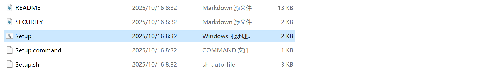

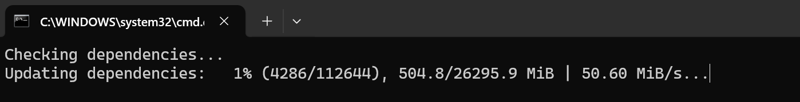

- 双击 GenerateProjectFiles，为引擎创建项目文件。这个过程应该不超过一分钟即可完成。

后续如果切换版本，需要重新点击一下这个文件。

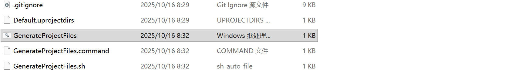

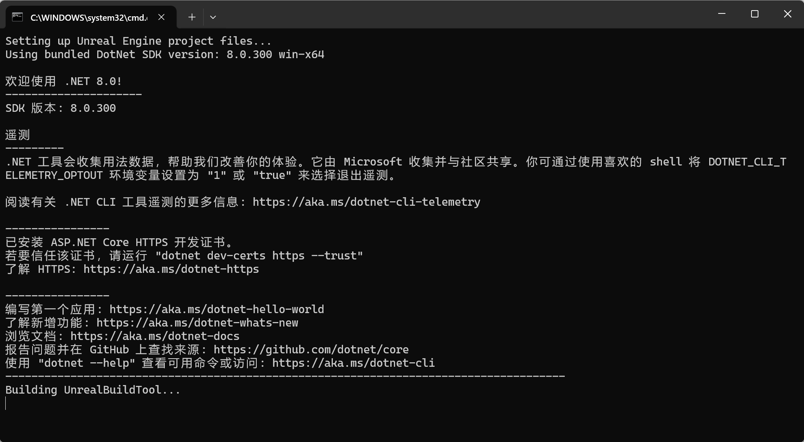

- 双击 UE5.sln 文件以将项目加载到 Visual Studio 中。将你的解决方案配置设置为开发编辑器（Development Editor），将解决方案平台设置为 Win64，然后右键点击 UE 目标并选择编译（Build）。大概需要 10-40 分钟完成编译，具体取决于系统规格。

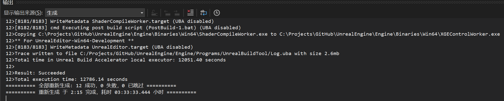

- 编译完成后，可以将启动项目设置为 UE5 并按 F5 进行调试，以便从 Visual Studio 加载编辑器。

## 安装 Visual Studio

选择必备的工具：[为虚幻引擎 C++ 项目设置 Visual Studio 开发环境 | 虚幻引擎 5.4 文档 | Epic Developer Community](https://dev.epicgames.com/documentation/zh-cn/unreal-engine/setting-up-visual-studio-development-environment-for-cplusplus-projects-in-unreal-engine)

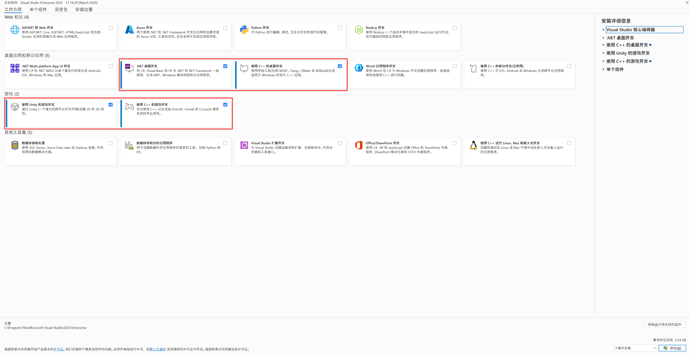

### .NET 桌面开发

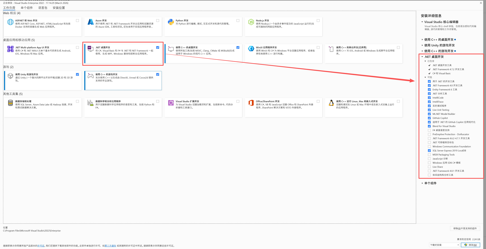

### 使用 C++ 的桌面开发

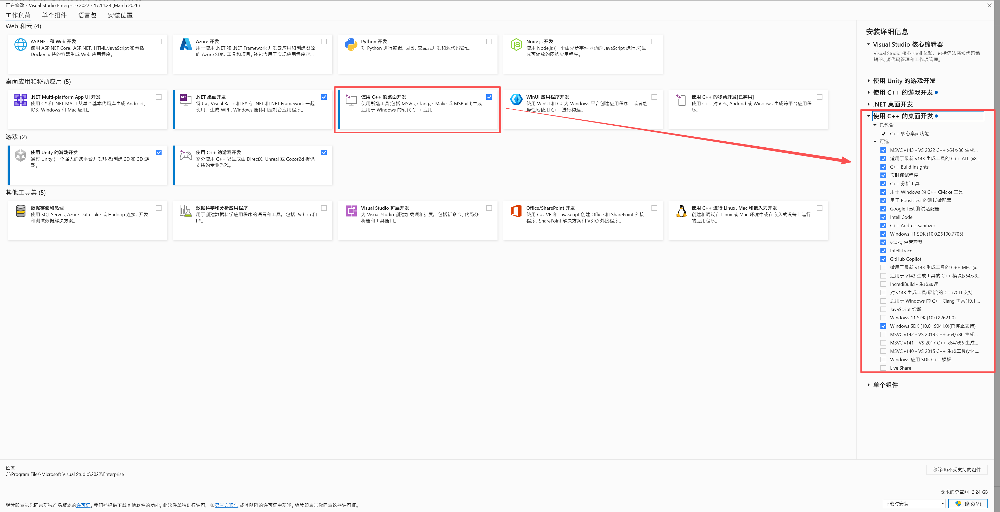

### 使用 Unity 的游戏开发

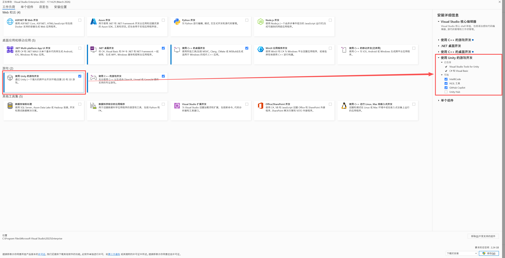

### 使用 C++ 的游戏开发

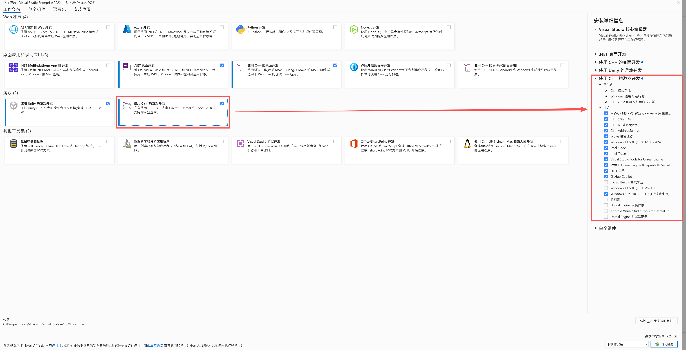

### 单个组件

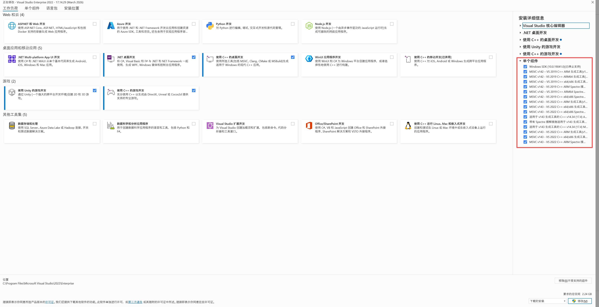

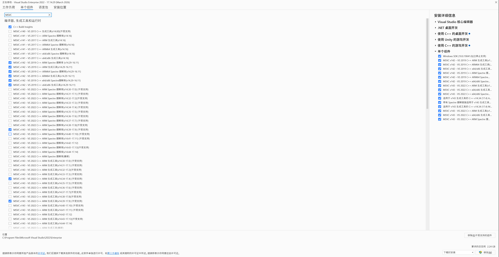

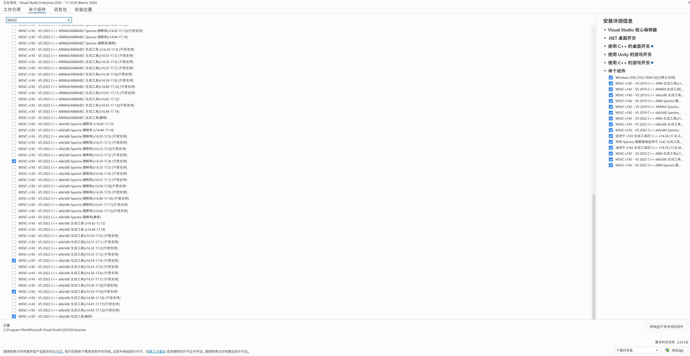

### MSVC 编译器的选择

此部分选错在通过 VS 启动项目时会报错 MSB3073，可以同时安装多个 MSVC。

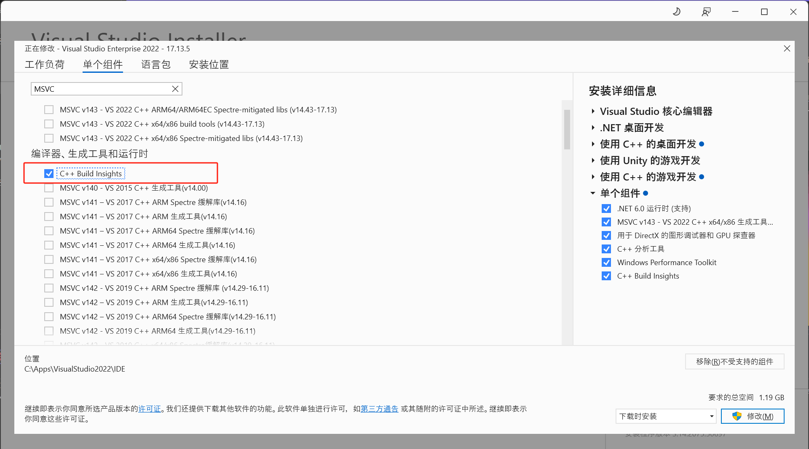

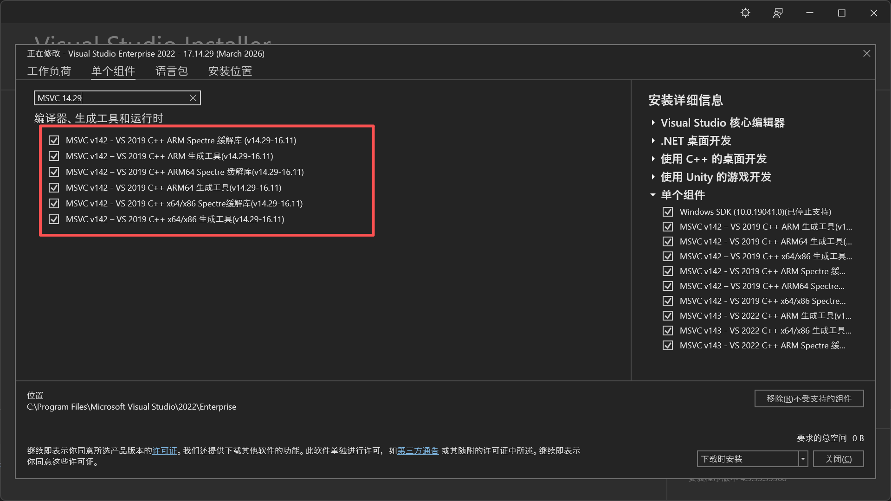

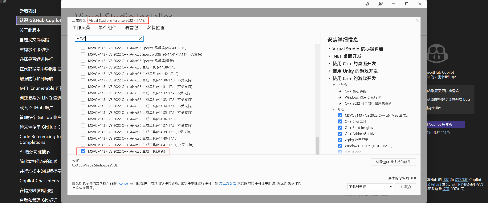

## 安装 Rider
